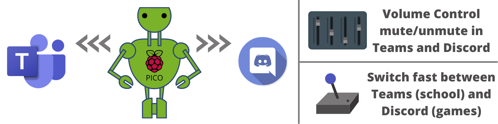
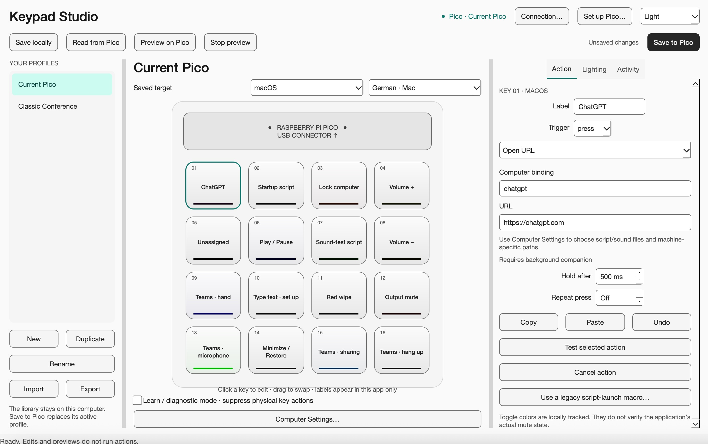
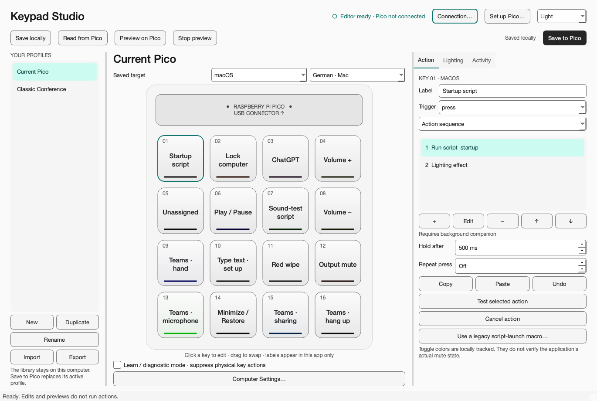
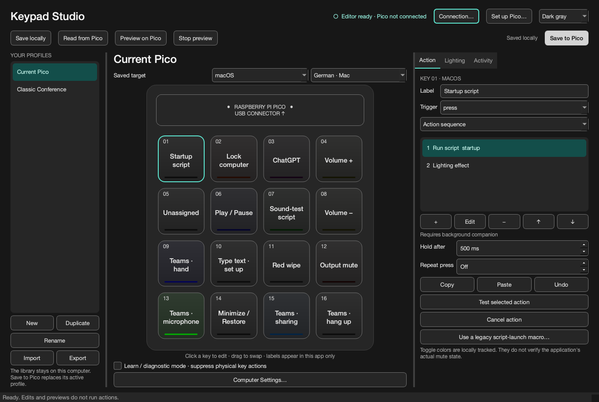

# Keypad Studio



[](https://www.python.org/)
[](docs/legacy-readme.md "Original MicroPython implementation")
[](#use-it)
[](LICENSE)

A visual Mac and Windows editor for the **Raspberry Pi Pico + Pimoroni RGB Keypad Base**.
Click a virtual key, choose actions and lighting, and save the active profile to the Pico.



## Hardware

A Raspberry Pi Pico mounted on the Pimoroni RGB Keypad Base, with 16 illuminated keys.


## Use it

1. Open **Keypad Studio**. The editor works without a connected device.
2. Select **Current Pico** or **Classic Conference**, or create a new profile.
3. Choose the target OS and keyboard layout. German Mac and Windows are distinct.
4. Click a virtual key to edit its action, sequence, timing and lighting. Drag keys to
   swap assignments; Copy/Paste and Undo are available. Click a sequence step and
   Edit to configure it without writing JSON.
5. Use **Computer Settings** to select scripts, interpreters, sound files and app paths.
6. Preview lighting locally or on the connected Pico. Preview never saves flash or
   triggers physical key actions.
7. **Save locally** keeps the profile in your computer's library. **Save to Pico**
   replaces only its active profile, verifies it by reading it back, and persists it
   across unplugging.

Keyboard shortcuts, media controls, text, keyboard macros and lighting work with the
app fully quit. Scripts, app launch/focus, URLs and computer-side sequences require
the background companion. Closing the window keeps the menu-bar/tray companion
running. Choose **Quit** in its menu to stop it. Launch the app at login using the
operating system's Login Items / Startup Apps if desired.

**Set up Pico** provides backup, CircuitPython upgrade and firmware installation
steps. Normal operation hides the CIRCUITPY drive so only firmware writes its files.
See [firmware setup and recovery](docs/firmware.md).

## Appearance

Use the top-right selector for **Dark gray**, **Light**, or **Follow system**. Your
choice stays on this computer and does not change any Pico lighting values. Both
themes use neutral surfaces from the [shadcn v3 palette](https://v3.shadcn.com/colors),
with readable text, visible focus indicators and muted dark-mode accents, informed
by the [UX Design Institute guide](https://www.uxdesigninstitute.com/blog/dark-mode-design-practical-guide/).

<details>
<summary>Compare light and dark-gray themes</summary>

| Light | Dark gray |
| --- | --- |
|  |  |

</details>

## Starter profiles

**Current Pico** reproduces the connected device's shortcuts, media keys, animations,
and locally tracked toggles, with Mac variants. Script keys use the reliable direct
runner by default. Choose **Use a legacy script-launch macro** to use standalone
Windows PowerShell launch sequences instead; edit their text steps to set your path.
The original text-entry key is intentionally empty until re-entered.

**Classic Conference** preserves the earlier Teams/Discord layout, including the ZIP
extraction key that the old firmware did not dispatch. Application volume controls
work on Windows; these bindings are unassigned on macOS. Configure local paths before
using script, sound, download or app-specific actions.

Shortcut-driven colors track presses, not the actual application mute state. Use
Learn / diagnostic mode to confirm the physical positions before saving mappings.
The default view has the Pico at the top: keys 1–4 across the first row, 13–16 across
the last. The physical corner positions were checked on the connected device.

## Run from source

Python 3.10–3.13 (3.11 recommended):

```sh
python3 -m venv .venv
source .venv/bin/activate       # Windows: .venv\Scripts\activate
python -m pip install -e ".[dev]"
python -m keypad_studio
```

Use `--learn` to start with physical actions suppressed, or `--no-device` for a
hardware-free editor. Mac computer-side keyboard injection may require Accessibility
permission; standalone USB keyboard actions do not use that permission.

Settings and profiles normally live in the OS application-data directory. Set
`KEYPAD_HOME` to choose a different directory. Machine-specific paths are separate
from exported/device profiles. Only one companion instance runs at a time.

## Build standalone applications

```sh
python tools/build_firmware.py
python tools/build_app.py
```

The Mac result is `dist/Keypad Studio.app`; Windows produces
`dist/Keypad Studio/Keypad Studio.exe`. Build on each target OS. Users do not need
Python to run these packages. Running their own Python scripts still requires a
chosen Python interpreter. The included GitHub Actions workflow tests and packages
Mac and Windows independently. Local builds are unsigned; signing/notarization can
be added for public distribution using the publisher's credentials.

## Develop and extend

- `keypad_core/`: portable schema, effects, cooperative scheduler, storage and protocol.
- `keypad_studio/`: editor, local library, USB worker, script runner and OS adapters.
- `firmware/`: CircuitPython entry points and the small hardware adapter.
- `tests_v2/`: isolated automated tests; old `tests/` files are historical scripts that
  can trigger real automation and are deliberately excluded from test discovery.
- [Profile/action/protocol reference](docs/profile-format.md), including script feedback.
- [Validation results and remaining platform checks](docs/validation.md).
- `examples/progress_script.py`: a script that reports progress and a key state.

```sh
python -m pytest
python -m black --line-length 100 keypad_core keypad_studio firmware tools tests_v2 examples
```

The original `script.py`, `pico_code.py`, images and audio remain available for
reference. Their original documentation is in [the legacy README](docs/legacy-readme.md).
